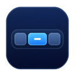
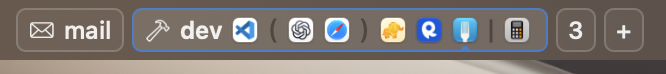

<p align="center">
  
</p>

<h1 align="center">DefiBar</h1>

<p align="center"><a href="README.md">English</a> · <strong>日本語</strong></p>

[Defi](https://github.com/qeude/Defi) のワークスペースを macOS のメニューバーに横一列で表示します。表示対象は Defi がフォーカス中と報告するディスプレイです。名前のあるワークスペースには名前を、名前のないワークスペースには番号を表示します。



- ワークスペースのボタンをクリックすると、そのディスプレイ上で切り替わります。
- 標準表示では、アクティブなワークスペースにアプリごとに1つのアイコンを表示します。アプリアイコンをクリックしたときの動作は、ワークスペースのボタンと同じです。
- DefiBar の表示領域を右クリックし、**ウインドウの並びを表示**をオンにすると、アクティブなワークスペースにウインドウごとのアイコンが並びます。アイコンをクリックすると、そのウインドウにフォーカスが移ります。括弧は同じ列に縦積みされたウインドウを示し、`|` の右側にはフローティングウインドウが並びます。アイコン下の印は選択中のウインドウを示します。アイコンにポインタを合わせると、アプリ名と、取得できる場合はウインドウタイトルが表示されます。
- 右クリックメニューでは、**ログイン時に起動**の切り替え、**DefiBarについて**でのバージョン確認、Defi の設定、DefiBar の終了ができます。ワークスペースを表示できないときは、メニューバーに DefiBar のアイコンが表示されます。アイコンにポインタを合わせるか、右クリックメニューを開くと状態を確認できます。

## ビルドと起動

macOS 15.4 以降、Swift 5.9 以降、および Defi 0.9 以降が必要です。プロジェクトのディレクトリで次を実行してください。Defi と DefiBar はどちらを先に起動しても構いません。

ウインドウの並び表示には、ワークスペースごとのウインドウ情報を提供する Defi が必要です。その情報がない場合は標準のサマリ表示になります。タイトルが取得できない場合は、ツールチップにアプリ名だけを表示します。

```sh
./build-app.sh
open .build/DefiBar.app
```

DefiBar は `~/Applications/Defi.app`、`/Applications/Defi.app`、実行時の `PATH` の順に CLI を探します。別の場所にある CLI を指定する場合は、アプリを終了してから絶対パスを使って起動できます。

```sh
DEFI_BIN="/path/to/defi" .build/DefiBar.app/Contents/MacOS/DefiBar
```

DefiBar の起動時に Defi CLI で初期状態を取得します。Defi がまだ応答できない場合は、Defi のワークスペース変更通知を待ちます。通知に含まれる JSON で表示を更新します。通知から状態を取得できない場合は CLI で再取得します。SketchyBar 本体のインストールは不要です。

連携仕様は [Defi の SketchyBar 連携ドキュメント](https://github.com/qeude/Defi/blob/main/contrib/sketchybar/README.md)を参照しています。

### MIT License

DefiBar は [MIT License](LICENSE) で公開しています。
