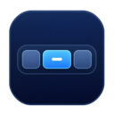
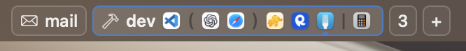

<p align="center">
  
</p>

<h1 align="center">DefiBar</h1>

<p align="center"><strong>English</strong> · <a href="README.ja.md">日本語</a></p>

DefiBar displays [Defi](https://github.com/qeude/Defi) workspaces in a single row in the macOS menu bar. It shows workspaces for the display that Defi reports as focused. Named workspaces show their names, and unnamed workspaces show their numbers.



- Click a workspace button to switch to that workspace on the display.
- By default, the active workspace shows one icon per app. Clicking an app icon is the same as clicking its workspace button.
- Right-click the DefiBar area and choose **Show Window Arrangement** to show one icon per window in the active workspace. Click an icon to focus its window. Parentheses group windows stacked in the same column, and floating windows appear after a `|` separator. The mark below an icon shows the selected window. Hover over an icon to see its app name and window title, when available.
- The right-click menu also lets you enable **Launch at Login**, check the version under **About DefiBar**, open Defi settings, or quit DefiBar. When workspaces are unavailable, the DefiBar icon appears in the menu bar. Hover over it or open the right-click menu to check the current status.

## Build and run

You need macOS 15.4 or later, Swift 5.9 or later, and a Defi build that includes [workspace window layout support](https://github.com/qeude/Defi/pull/282). Run the following from the project directory. You can start Defi and DefiBar in either order.

```sh
./build-app.sh
open .build/DefiBar.app
```

DefiBar looks for the CLI in `~/Applications/Defi.app`, `/Applications/Defi.app`, and then on its runtime `PATH`. To use a CLI in another location, quit DefiBar and relaunch it with the absolute path to the CLI.

```sh
DEFI_BIN="/path/to/defi" .build/DefiBar.app/Contents/MacOS/DefiBar
```

On startup, DefiBar uses the Defi CLI to fetch the initial workspace state. If Defi cannot respond yet, DefiBar waits for a workspace change notification from Defi. It updates the display using the JSON in the notification. If the notification does not provide the workspace state, DefiBar fetches it again through the CLI. SketchyBar itself is optional.

For integration details, see [Defi’s SketchyBar integration documentation](https://github.com/qeude/Defi/blob/main/contrib/sketchybar/README.md).

### MIT License

DefiBar is released under the [MIT License](LICENSE).
