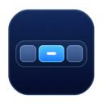
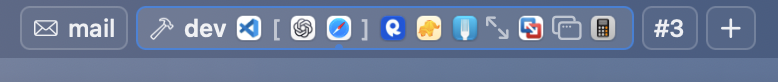

<p align="center">
  
</p>

<h1 align="center">DefiBar</h1>

<p align="center"><strong>English</strong> · <a href="README.ja.md">日本語</a></p>

DefiBar displays [Defi](https://github.com/qeude/Defi) workspaces in a single row in the macOS menu bar. It shows workspaces for the display that Defi reports as focused. By default, named workspaces show their names, and unnamed workspaces show their numbers.



- Click a workspace button to switch to that workspace on the display.
- **Workspaces Shown on Either Side** limits how many workspaces appear before and after the active workspace. Choose **None** to show only the active workspace, **1–5** to set a maximum for each side (default **2**), or **All** to show every workspace.
- When window icons are enabled, the active workspace shows one icon per window. Click an icon to focus its window. Square brackets group windows stacked in the same column. A diagonal arrow symbol marks native fullscreen windows when Defi reports their status, and an overlapping window symbol marks floating windows. The mark below an icon shows the selected window. Hover over an icon to see its app name and window title, when available.
- When the window strip exceeds **Maximum Window Strip Width** (144 pt by default), chevrons show where more items extend beyond the visible area. To see more, point at the strip and swipe horizontally on the trackpad. When focus moves to a partially or fully hidden icon, the strip scrolls just far enough to show the whole icon.
- With **Show Workspace Info When Switching** enabled, a heads-up display (HUD) shows the workspace label and its icon, if available, on the focused display. It can also show the workspace’s apps and highlight the focused app. App icons wrap onto additional rows as needed. The HUD fades out on its own after about a second.
- Open **Settings…** from the right-click menu to configure **Launch at Login**, the menu bar display, and workspace info. The settings window also shows the version under **About DefiBar**. The menu lets you start or quit Defi, open Defi settings, or quit DefiBar. When workspaces are unavailable, the DefiBar icon appears in the menu bar. Hover over it or open the right-click menu to check the current status.

## Build and run

DefiBar runs on macOS 15.4 or later and requires Defi 0.11.0 or later. To build from source, use Xcode with the macOS 26 SDK or later. Run the following from the project directory. You can start Defi and DefiBar in either order.

```sh
./build-app.sh
open .build/DefiBar.app
```

The `DefiBar.app` built by `build-app.sh` is not notarized by Apple. If you download the built app onto another Mac, macOS may block it from opening the first time. See [Apple’s guide to safely opening apps on your Mac](https://support.apple.com/en-us/102445).

Sparkle-enabled releases offer **Check for Updates…** in the right-click menu. If you installed v0.4.0 or earlier, install a Sparkle-enabled release manually once. See the [release instructions (Japanese)](docs/releasing.md) for preparing signed updates.

DefiBar looks for the CLI in `~/Applications/Defi.app`, `/Applications/Defi.app`, and then on its runtime `PATH`. To use a CLI in another location, quit DefiBar and relaunch it with the absolute path to the CLI.

```sh
DEFI_BIN="/path/to/defi" .build/DefiBar.app/Contents/MacOS/DefiBar
```

On startup, DefiBar uses the Defi CLI to fetch the initial workspace state. If Defi cannot respond yet, DefiBar waits for a workspace change notification from Defi. It updates the display using the JSON in the notification. If the notification does not provide the workspace state, DefiBar fetches it again through the CLI. SketchyBar itself is optional.

For integration details, see [Defi’s SketchyBar integration documentation](https://github.com/qeude/Defi/blob/main/contrib/sketchybar/README.md).

### MIT License

DefiBar is released under the [MIT License](LICENSE).
